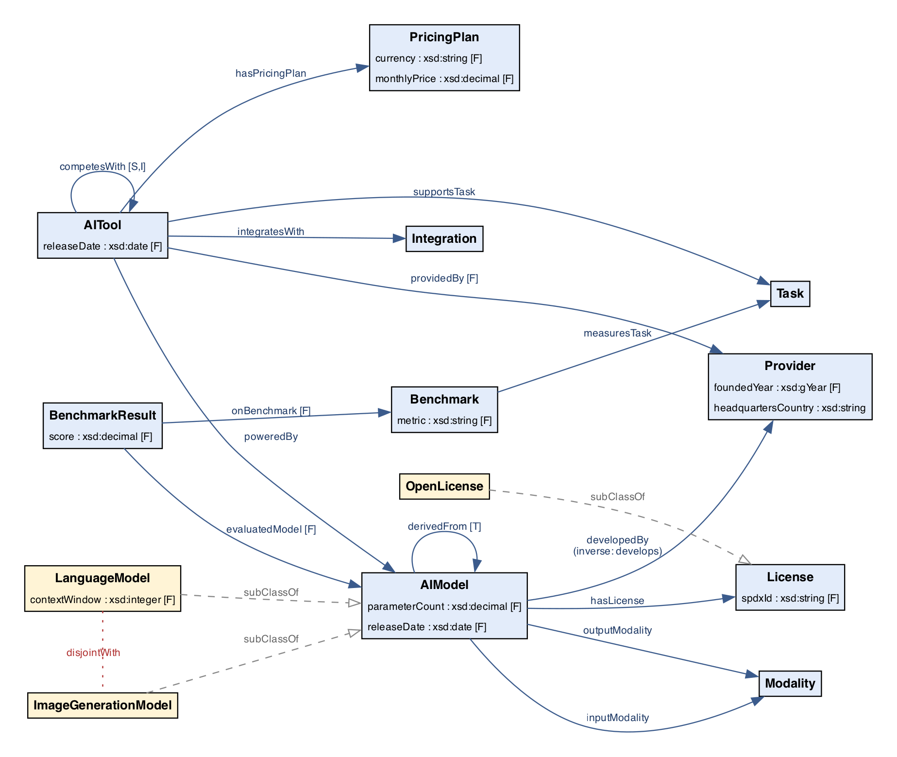

# AI Tools Catalogue — Knowledge Graph

Semestral project for the course **4IZ444** (Prague University of Economics and Business, Faculty of Informatics and Statistics, winter semester 2026/2027).

Authors: **Ota Vlna**, **Matěj Fadrhons**

A knowledge graph describing AI tools (ChatGPT, Claude, Gemini, Midjourney, GitHub Copilot, Cursor, …), the AI models that power them, their providers, supported tasks, modalities, licences, integrations, pricing plans and benchmark results.

📄 **Full report:** [`report/report.pdf`](report/report.pdf) (Word version in the FIS template: [`report/report.docx`](report/report.docx))



## Contents

| Path | Description |
|---|---|
| [`ontology/ai-tools.ttl`](ontology/ai-tools.ttl) | OWL 2 ontology — 13 classes, 15 object + 10 datatype properties, axioms (disjointness, functional / inverse / transitive / symmetric / irreflexive properties, union domain), aligned to schema.org, W3C ML Schema, Dublin Core, FOAF, SKOS |
| [`data/ai-tools-data.ttl`](data/ai-tools-data.ttl) | Knowledge graph — ~990 triples: 15 tools, 27 models, 12 providers, 34 pricing plans, 44 benchmark results |
| [`data/ai-tools-data-invalid.ttl`](data/ai-tools-data-invalid.ttl) | Intentionally invalid data to demonstrate SHACL validation |
| [`queries/`](queries/) | SPARQL queries — competency questions CQ1–CQ10 and analytical queries Q11–Q15 |
| [`shacl/shapes.ttl`](shacl/shapes.ttl) | SHACL shapes S1–S10 (11 node shapes covering every class, incl. a SPARQL-based constraint) |
| [`results/`](results/) | Query results (CSV / Markdown / Turtle) and SHACL validation reports |
| [`scripts/build.py`](scripts/build.py) | Build pipeline: parsing, documentation check, OWL RL reasoning + consistency check, queries, SHACL, diagram, report assembly |
| [`report/report.md`](report/report.md), [`report/frontmatter.md`](report/frontmatter.md) | Report source (placeholders are filled in by the build) |
| [`scripts/build_docx.py`](scripts/build_docx.py), [`scripts/make_pdf.py`](scripts/make_pdf.py) | Conversion of the report into the FIS Word template ([`report/template/fis-template.docx`](report/template/fis-template.docx)) and rendering to PDF |

## Competency questions

1. Which AI tools support code generation and can be used inside Visual Studio Code?
2. Which AI models accept images as input and produce text, and in how many tools are they used?
3. What is the average / min / max monthly price of paid plans per provider?
4. Which openly licensed models perform best on MMLU, and how large are they?
5. How many AI tools support each task?
6. Which AI tools are powered by models of a different provider?
7. What is the complete lineage of a given model?
8. Which language model has the largest context window for each provider?
9. Which providers offer both text and image generation?
10. Which AI tools can be used for free and run on an openly licensed model?

## Build

Requirements: Python 3.10+, [Graphviz](https://graphviz.org/), [pandoc](https://pandoc.org/) and [LibreOffice](https://www.libreoffice.org/) (DOCX → PDF).

```bash
make venv     # create .venv and install rdflib, pyshacl, owlrl
make build    # run checks, queries, SHACL, generate diagram + build/report.md
make docx     # fill the FIS Word template -> report/report.docx
make pdf      # render report/report.pdf (table of contents filled in)
make zip      # build/4iz444-ai-tools-kg.zip for submission in InSIS
```

The ontology can also be opened in [Protégé](https://protege.stanford.edu/).

## Data disclaimer

The data are a manually curated snapshot of the market as of 30 September 2025 (the reasons for the cut-off date are given in Section 3.2 of the report). Prices are list prices with monthly billing; benchmark scores are mostly vendor-reported and measured under different settings, so they are indicative only.
